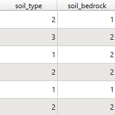

# Dűlő Analízis projekt (dulo_analizis)

---

---

## Rövid leírás

Ennek a projektnek a célja az, hogy Python segítségével automatiáltan elemezze
a borvidékek dűlőit különböző tulajdonságok mentén (talaj, domborzat,
éghajlat). (A kód futása automatikus és nem igényel felhasználói interakciót
futás közben).

A kód bemenetként a következő adatokat kapja:
- Vektor fájlok:
  - Dűlők poligonjai
  - Települések poligonjai
  - Borvidékek poligonjai
  - Borrégiók poligonjai
  - Talajok poligonjai és tulajdonságai

- Raster fájlok:
  - DEM
  - Meteorológiai adatok rasterei

Az eredmény:
- Egy GeoPackage ("vineyards_analytics.gpkg") állomány 5 réteggel:
  - Dűlők tulajdonságai önmagukban (vineyards)
  - Dűlők tulajdonságai településenként (settlements)
  - Dűlők tulajdonságai borvidékenkémt (wine_districts)
  - Dűlők tulajdonságai borrégiónként (wine_regions)
  - Dűlők tulajdonságai országosan (country)

Később bővebb kifejtésre kerül sor.

---

## Tartalomjegyzék
- [Rövid leírás](#rövid-leírás)
- [Projekt telepítése és futtatása](#projekt-telepítése-és-futtatása)
- [Bemeneti fájlok leírása](#bemeneti-fájlok-leírása)
- [Elemzési folyamat leírása](#elemzési-folyamat-leírása)
  - [1. lépés: Adatok beolvasása](#1-lépés-adatok-beolvasása)
  - [2. lépés: Vektoros adatok előkészítése](#2-lépés-vektoros-adatok-előkészítése)
  - [3. lépés: Rasteres adatok előészítése](#3-lépés-rasteres-adatok-számítása)
  - [4. lépés: Rasterek kapcsolása a poligonokhoz](#4-lépés-rasterek-kapcsolása-a-poligonokhoz)
  - [5. lépés: Eredmény adat készítése](#5-lépés-eredmény-adat-készítése)

---

---

## Projekt telepítése és futtatása

A projekt futtatásához szükség van egy [Python 3.x](https://python.org) 
interpreterre vagy egy [Anaconda/Miniconda](https://anaconda.com) környezetre.

### Telepítés Conda használatával (Ajánlott megoldás)

Anaconda vagy Miniconda használat mellett, ez a módszer automatikusan 
létrehozza a Python környezetet (environment) a megfelelő Python verzióval és
az összes szükséges csomaggal a környezetet leíró 'environment.yml' fájl 
alapján.

1. lépés: Nyiss egy Parancssort (Terminált), és lépj be a projekt mappájába:
```bash
cd dulo-analizis
```

2. lépés: Virtuális környezet létrehozása:
```bash
conda env create -f environment.yml
```

3. Létrehozott környezet aktiválása:
```bash
conda activate dulo_analizis_env
```


### Telepítés hagyományos Python és pip segítségével

Conda használata nélkül is létrehozható egy normál Python virtuális környezet,
majd a szükséges függőségek telepíthetők a 'requirements.txt' fájl alapján.

1. lépés: Nyiss egy Parancssort (Terminált), és lépj be a projekt mappájába:
    ```bash
    cd dulo-analizis
    ```

2. lépés: Virtuális környezet létrehozása (nem kötelező, de erősen ajánlott):
* Windows esetében:
```bash
python -m venv venv
venv\Scripts\activate
```

* macOS / Linux esetében:
```bash
python3 -m venv venv
source venv/bin/activate
```

3. Telepítsd a szükséges csomagokat:
* Windows esetében:
```bash
pip install -r requirements.txt
```

   * macOS / Linux esetében:
    ```bash
    pip3 install -r requirements.txt
    ```

### config.py

A telepítés után, de a futtatás előtt át kell nézni a [config.py](config.py)
tartalmát és kiegészíteni (behelyettesíteni a saját értékekkel).

A fontosabb átnézendő értékek:
- Vektor állományok átnézése:
  - Vektor állományt tartalmazó fájl elérési útja (_FILE_PATH).
  - Layer (réteg) neve (amennyiben GeoPackage (.gpkg) állományról van szó) 
    (_LAYER_NAME).
  - Annak a mezőnek a neve, amely az elemek (dŰlő, település stb.) nevét 
    (_NAME_FIELD) tartalmazza.
  - Talajok esetében a SOILS_PROPERTY_FIELDS érték várja azokat a mezőket, 
    amelyek tartalmazzák a talajok kategorizált tulajdonságait.
  - Csak a dűlők (VINEYARDS) és a talajok (SOILS) adatai kötelezők a vektoros
    adatok között.
  - Ha a települések, a borvidékek vagy borrégiók közül valamelyikhez nincs
    adat, akkor egyszerűen None értéket kell adni.
    - SETTLEMENTS_FILE_PATH = None
    - WINE_DISTRICTS_FILE_PATH = None
    - WINE_REGIONS_FILE_PATH = None
- Raster-es mappák elérési útja:
  - DEM ("_elevation.tif"-re kell végeződnie a DEM fájlnak 
    (pl. srtm_elevation.tif) --> a mappában csak egy "_elevation.tif" fájl 
    legyen)
  - Meteorológiai adatok
  - A rastereknek kötelezően GeoTIFF (.tif) kiterjesztésűnek kell lenniük
  - (Lehetnek egy szinttel "beljebb" lévő mappák is 
    (pl. sok meteorológiai adat esetében))
- Eredmény fájlok mappái:
  - Külön mappa lehet vektor állományoknak DEM-alapú fájloknak, 
    meteorológiai fájloknak.
  - Nem baj, ha ezek még nem léteznek a kód létre hozza őket, ha még nem
    léteznek.
- A újraosztályozás szabályait (_RELCASSIFICATION_RULES) is lehet módosítani
  (de már Magyarország dűlőire optimalizáltak).
- Az eredmény mezők kezelése (FIELD_NAMES):
  - dict-alapú --> 'key' az eredeti vagy létrejövő mezőnév, az 'value' pedig 
    az új mezőnév (nem kötelező).
  - Ha egy üres str ("") az 'value' a 'key' esetében, akkor a 'key' marad a 
    mezőneve.
  - Ha a 'key' nem szerepel a mezők között az nem okoz hibát.
  - A 'key'-ek sorrendje határozza meg a mezők sorrendjét is.
  - Amely mezők nem szerepelnek a 'key'-ek között, azok az eredményben sem 
    fognak.

### Futtatás
Miután létrejött és aktiválásra került a környezet, valamint a config.py 
beállításai megtörténtek a kód futtatható a következő paranccsal:
""" bash
python main.py
"""

---

---

## Bemeneti fájlok leírása

### Vektor fájlok

1. Dűlők
   - Dűlők nevei és poligon geometriái (minden más attribútum figyelmen kívül
     hagyásra kerül).
   - Lehetséges adatforrás(ok):
     - [VINGIS](https://vingis.hu/eredetvedelem) felületén elérhető térképek
       alapján a dűlőket ki lehet nyerni georeferálással, majd 
       digitalizálással.


2. Települések
   - Települések nevei és poligon geometriái (minden más attribútum figyelmen 
     kívül hagyásra kerül).
   - Lehetséges adatfoorrás(ok):
     - [Overpass Turbo](https://overpass-turbo.eu/) lekérdezéssel nyerhetők ki
       a települések.
     - [Geofabrik](https://download.geofabrik.de/europe/hungary.html) nem csak
       a településeket tartalmazza (megye, járás stb.) OpenStreetMap alapján.
     - [data2openstreetmap.hu](https://data2.openstreetmap.hu/hatarok/kozighatarok.zip)
       szintén nem csak a településeket tartalmazza.
     - [geoBoundaries](https://www.geoboundaries.org/countryDownloads.html) itt
       is megtalálhatók a települések "Hungary"-ra keresve, ADM3 jelöli a
       településeket.


3. Borvidékek
   - Borvidékek nevei és poligon geometriái (minden más attribútum figyelmen 
     kívül hagyásra kerül).
   - Lehetséges adatforrás(ok):
     - Elsődelegesen is kellenek a település határok ezt követően a 
       településeket össze kell vonni borvidékek alapján 
       (pl. [Winelovers Online](https://wineloversonline.hu/tudastar/borvidekek/)).


4. Borrégiók
   - Borrégiók nevei és poligon geometriái (minden más attribútum figyelmen  
     kívül hagyásra kerül).
   - Lehetséges adatforrás(ok):
     - Hasonlóan a borvidékekhez szintén a 
       [Winelovers Online](https://wineloversonline.hu/tudastar/borvidekek/) 
       oldala nyújt segítséget.


5. Talajok
   - Poligon geometria
   - Különböző talajtulajdonságok (pl. alapkőzet, termőréteg vastagság) és 
     geometria.
   - Kategorikus értékek (int értékek jelölik a kategóriákat).
   - (Fontos a kategóriák jelentésének ismerete az elemzés további szakaszában, 
     de ez a kód szempontjából csak a FIELD_NAMES (config.py) esetében fontos 
     (ott sem kötelező megadni)).
   - Lehetséges adatforrás(ok): 
     - [AGROTOPO](https://experience.arcgis.com/experience/6b9eaf7ab1c3439db9c1d2e1e11d70db)
     - [DOSoReMI](https://dosoremi.hu/maps/genetikus-tipus/)
   - Példa a réteg kategorikus értékeire (minden kategóriának (számnak) 
     jelentése van):




Ezen adatoknak Magyarországra kell vonatkozni a optimalizáció miatt 
(pl. crs - "EPSG:23700", újraosztályozás szabályai)

### Raster fájlok

1. DEM fájl
   - A DEM fájlnak a megadott mappában (DEM_FILE_DIRECTORY_PATH - config.py) 
     vagy maximum eggyel beljebb lévő mappában kell lennie.
   - A DEM fájl nevének "_elevation.tif"-re (GeoTIFF fájl) kell végződnie 
     (pl. "srtm_elevation.tif") és csak egy fájl legyen a megadott mappa 
     struktúrán belül.
   - Lehetséges adatforrás(ok):
     - [SRTM DEM](https://earthexplorer.usgs.gov/) a NASA és nemzetközi 
       partnereik által elvégzett küldetés (Shuttle Radar Topography Mission)
       során InSAR technológiával elkészített DEM (Digital Elevation Model - 
       Digitális Domborzatmodell).
     - [Copernicus DEM](https://dataspace.copernicus.eu/) az egyik 
       legpontosabb, szabadon elérhető globális DEM. Ezt a domborzatmodellt
       a DLR (Német Légügyi és Űrkutatási Központ) és az Arbus Defence and 
       Space készítette.
     - [EuroDEM](https://www.mapsforeurope.org/datasets/euro-dem) az 
       EuroGeographics által készített nyílt hozzáférésű páneurópai DEM, amely
       a csupasz felszínt ábrázolja, tehát egy DTM-ről (Digital Terrain Model -
       Digitális Terepmodell) van szó.
     - [ASTER GDEM](https://www.jspacesystems.or.jp/ersdac/GDEM/E/) egy olyan
       DEM, amelyet a NASA Terra műholdján lévő ASTER szenzor adataiból hoztak
       létre (tehát lényegében egy USA - Japán együttműködésben jött létre)
     - [OpenTopography](https://opentopography.org/) egy olyan online platform,
       amelyen sok nagy felbontású topográfiai adathoz (így DEM-hez is) 
       biztosít hozzáférést. A rendszert több intézmány működteti (UCSD (
       Kaliforniai Egyetem), EarthScope Consortium stb.).


2. Meteorológiai fájlok
   - A meteorológiai fájlok esetében is kitétel a .tif (GeoTIFF) kiterjesztés
   - Amennyi fájl van, annyi meteorológiai "feature" (attribútum) fog tartozni
     az egyes dűlőkhöz.
   - A meteorológiai rastereknek folytonos értékeket kell tartalmazni a 
     DEM-hez hasonlóan
   - Lehetséges adatforrás(ok):
     - [KlimAdat](https://klimadat.met.hu/) ezen a weboldalon több idősávban
       (a projekt elkészültekor szerintem az 1996 és 2025 közötti adatok a 
       legrelevánsabbak) érhetők el meteorológiai adatok rasteres formátumban.
       Az adatok forrása a HungaroMet, amely olyan adatokat biztosít, mint a 
       napi átlaghőmérésklet, a napi csapadékösszeg vagy a csapadékos napok 
       száma. Az adatok általában hónapra, évszakra vagy évre érhetők el 
       (és tölthetők le) a kiválastott idősávra. A rasterek felbontása kb. 
       7,5 * 11 km-es,  eredetileg "EPSG:4326" (WGS84) CRS-ben, de a kód 
       átalakítja "EPSG:23700"-ra (EOV - Egységes Országos Vetület).

---

---

## Elemzési folyamat leírása

Az alábbiakban a kód működésének folyamat található részletesebben kifejtve.

Az elemzési folyamat 5 nagyobb lépésre bontható:
1. Adatok beolvasása
2. Vektoros adatok előkészítése
3. Raster adatok számítása
4. Raster-ek kapcsolása poligonokhoz
5. Eredmény adat előállítása

Az elemzés folyamatát természetesen a [main.py](main.py) fogja össze.

---

### 1. lépés: Adatok beolvasása

Az adatok beolvasásáról (betöltéséről) a [load_data.py](src/load_data.py) 
modul gondoskodik, amely közvetlenül [src](src) mappában található.

Vektoros adatok:
- Az adatbeolvasás első lépése a vektoros adatok beolvasása 
  (load_vector_files() függvény).
- A vektoros adatokat a kód a [GeoPandas](https://geopandas.org/en/stable/) segítségével 
  [GeoDataFrame](https://geopandas.org/en/latest/docs/reference/api/geopandas.GeoDataFrame.html) 
  objektumokba tölti be a kód a config.py-ban megadott értékek alapján. 
- A vektoros állományok elérési útján (_FILE_PATH) található fájl tartalmazza
  az elérési utakat.
- A fájlok típusa alapján (.shp vagy .gpkg) eldönti, hogy van-e  szükség a 
  réteg ismeretére (.gpkg - GeoPackage esetében több réteg is lehet a 
  fájlban).
- A GeoDataFrame-ek CRS-e egységesen "EPSG:23700" lesz, a későbbi problémák 
  elkerülése végett.
- A vektoros adatok esetében fontosak az  attribútumok, itt kerül képbe a 
  neveket tartalmazó mezők (_NAME_FIELD) nevei.
- A neveket tartalmazó mező tartalomnak megfelelően átnevezésre kerül 
  (dűlők esetében: "name", települések esetében: "settlement",
  borvidékek esetében: "wine_district", borrégiók esetében: "wine_region"),
  ennek az oka az, hogy biztosan ne legyen ütközés a mezőnevekben.
- A betöltés után a GeoDataFrame-ekben csak a neveket tartalmazó mező és a 
  geometriát tartalmazó oszlop fog szerepelni.
- Ez alól kivételt jelentenek a talajok adatai, ugyanis ott a config.py-ban
  SOILS_PROPERTY_FIELDS-nek a list-ben megadott mezőnevek fognak szerepelni a 
  geometria mellett.
- A GeoDataFrame-ket a kód egységesen egy dict-ben tárolja el, végig kíséri a
  futás folyamatát.

Rasteres adatok:
- Az adatbeolvasás másik fontos része a rasteres adatok beolvasása 
  (load_raster_files() függvény).
- A rasteres fájlokat két mappában keresi a kód, az egyik a config.py-ban a 
  DEM_FILE_DIRECTOTY_PATH-nak (DEM fájl) megadott mappa, másik szintén a 
  config-ban található METEOROLOGICAL_RASTER_DATA_DIRECTORY_PATH 
  (meteorológiai rasterek).
- A rasterek megnyitásáról (nem betöltés, mert az a memória szempontjából nem 
  lenne hatékony megoldás) a 
  [Rasterio](https://rasterio.readthedocs.io/en/stable/https://rasterio.readthedocs.io/en/stable/) 
  és annak a 
  [DatasetReader](https://rasterio.readthedocs.io/en/latest/topics/reading.html) 
  osztálya gondoskodik.
- A rastereket a megnyitás, majd ideiglenes betöltés után egységesen
  "EPSG:23700"-as CRS-be vetíti át a kód a Rasterio segítségével.
- Az átvetítés során létrehozott fájlokat pedig a config.py-ban megadott 
  mappákban (RESULT_DEM_FILES_DIRECTORY_PATH és 
  RESULT_METEOROLOGICAL_FILES_DIRECTORY_PATH) menti és az új elérési utakat el
  is tárolja a raster neveivel együtt egy dict-ben.
- A fő dict-en belül két dict találhatő. Egy a DEM-alapú fájloknak, egy pedig
  a meteorológiai rasteres fájloknak. Ez a dict is végig kíséri a kód futását.

Az adatok betöltésének folyamatát a load_data.process() függvény fogja össze,
amely a [main.py](main.py)-ban kerül meghívásra.

---

### 2. lépés: Vektoros adatok előkészítése

A vektoros adatok előkészítését a 
[prepare_vector_data.py](src/prepare_vector_data.py) modul valósítja, amely
közvetlenül az [src](src) mappában található.

Dűlők adatainak kiegészítése:
- A vektoros adatok előkészítésének első lépése a dűlők adatainak előkészítése,
  amelyet a prepare_vector_data.supplement_vineyard_data() függvény végez el.
- Az adatok kiegészítésének első lépése a dűlők nevének ábécé sorrendbe (közel
  ábécé sorrendbe) állítása.
- A sorbarendezés után minden dűlőhöz tartozni fog egy id, amelyet az "id" mező
  fog tartalmazni. Erre azért van szükség, mert lehetséges, hogy öbb dűlőnek is
  ugyanaz a neve (pl. Öreg-hegy nevű dúlőből elég sok van az országban). Az id
  a GeoDataFrame-ek sor-indexe alapján kerül meghatározásra (tehát 0-tól
  kezdődően egyesével növekedve van a számozás a dűlők számának megfelelően).
- Ezen kívül a dűlők területével kerül kiegészítésre az adat. A dűlők területe,
  mind négyzetméterben ("area_m2" mező), mind hektárban ("area_ha" mező)
  elérhető az összes esetben.

Térbeli összekapcsolás a dűlők és határokat tartalmazó GeoDataFrame-ek között:
- Ezt a fajta térbeli összekapcsolást a prepare_vector_data.spatial_join()
  függvény hajtja végre.
- A függvény segítségével több körben térbeli összekapcsolás által
  meghatározásra kerülnek a dűlők települései, borvidékei és borrégiói (ezek a
  későbiekben még fontos szerepet fognak játszani).
- Az összekapcsolás során a dűlők középpontjának (centroid) geometriái vannak
  figyelembe véve. Ennek oka az, hogy egy dűlő jó esetben csak egy
  településhez, egy borvidékhez és egy borrégihoz tartozik, de a poligon
  geometria miatt előfordulhat hogy a körvonal érinti a "felsőbb" szintű
  geometriák határvonalát (vagy határvonalait), így például több település neve
  is kapcsolódik egy-egy dűlőhöz. Ez természetesen így is előfordulhat, ha a
  középpont pont a vonalon helyzkedik el, így ez kezelve van a kódban.
- Az összekapcsolás során csak a nevek kerülnek összekapcsolásra a dűlőkkel.
- Ha egy dűlőhöz nincs kapcsolható név, akkor a név helyére a "Nem ismert"
  érték kerül.

Talajok adatainak kapcsolása az egyes dűlőkhöz:
- A talajok adatainak dűlőkhöz való kapcsolását a
  prepare_vector_data.join_soils_propertirs_to_vineyards() függvény hajtja  
  végre.
- Ez az összekapcsolás is a térbeli összekapcsoláson alapul, de összetettebb
  módon kerül végrehajtásra, mint az előző esetekben.
- Itt nem a hagyományos térbeli összekapcsolása
  (geopandas.sjoin() függvény) a módszer alapja, hanem az átfedések
  (geopandas.overlay() függvény) számítása kerül előtérbe. Ez a talaj
  geometriák dűlőkön belüli kinyerése miatt fontos.
- Az "új" talaj geometriák területe kiszámításra kerül, amely azért fontos,
  hogy területi arányt lehessen számítani az egyes kategóriákhoz.
- És itt látszik, hogy miért fontos a bemeneti adatok esetében említett
  kategorizált talajértékek, ugyanis minden érték kategóriájának lesz egy
  0 és 1 közötti területi aránya. Például 3 kategória esetén: 0.237, 0.595 és
  0.168. (A kerekítések miatt kicsi eltérés lehet, pl. az arányok összege
  0.998 vagy 1.002)
- A talaj tulajdonságok alapján új attribútumok (és mezők) kerülnek a
  dűlők GeoDataFrame-jébe. Például soil_type (talaj típus) esetében 3 különböző
  kategória van '1', '2' és '3', akkora mezőnevek a következőképpen alakulnak:
  'soil_type_1', 'soil_type_2' és 'soil_type_3'. Ezek fogják az arányszámokat
  tartalmazni (pl. 'soil_type_1': 0.237, 'soil_type_2': 0.595, 'soil_type_3':
  0.168)

(A folyamat során a korábban említett GeoDataFrame-ek dict-je jelenti az adatok
 alapját, amelybe az előkészített adatok behelyettesítik az "eredetit".)

Az vektoros adatok előkészítésének folyamatát a prepare_vector_data.process() 
függvény fogja össze, amely a [main.py](main.py)-ban kerül meghívásra.

---

### 3. lépés: Rasteres adatok számítása

A rasteres adatok számítását a 
[calculate_raster_data.py](src/calculate_raster_data.py) modul valósítja, amely
közvetlenül az [src](src) mappában található.

Domborzati paraméterek kiszámítása:
- A domborzati paraméterek kiszámítását a
  calculate_raster_data.calculate_terrain_parameters() függvény végzi el.
- A számítások a Rust nyelven íródott [WhiteboxTools](https://whiteboxgeo.com/)
  alapján kerülnek végrehajtásra, így a legtöbb DEM-alapú raster számítása
  gyors és az  eredményfájlok mérete is veszteségmentesen tömörített (DEFLATE).
- 13 új raster keletkezik a számítások során, a következőkben ezek kerülnek
  bemutatásra. Az új rasterek elérési útjai eltárolásra kerülnek a rasterek
  elérési útjainak dict-jébe.


- Breach Depression (Mélyedések átvágása):
  - A Breach Depression lényegében az eredeti DEM, a különbség abban rejlik, 
    hogy a mélyedések átvágásra.
  - Az számítást a WhiteboxTools.breach_depresssions_least_cost() metódus hatja
    végre, amely során figyelembe vett távolság a DEM raster felbontása
    alapján alakul:
    - felbontás <= 5 méter: távolság = 50 méter,
    - 5 < felbontás <= 20 méter: távolság = 60 méter,
    - 20 méter < felbontás: távolság = 100 méter.
  - Az eredmény raster azért fontos, mert ez alapján a terep hidrológiai
    paramétereit is ki lehet számítani, mert azok nem akadnak el a
    "víznyelőkben".
  - Az eredményfájl neve "_breach_depression.tif"-re végződik.


- Slope (Lejtőszög):
  - A Slope a DEM alapján számított lejtőszögeket tartalmazza fokban 0 és 90°
    közötti értékként.
  - A számítást a WhiteboxTools.slope() metódus hajtja végre.
  - Az eredmény raster azt mondja meg, hogy az adott pontokon (pixeleken)
    mekkora a terep meredeksége (lejtése) fokban.
  - Ennek ismerete fontos a beérkező napsugárzás, illetve az erózió miatt is.
  - Az eredményfájl neve "_slope.tif"-re végződik.

    
- Aspect (Kitettség):
  - Az Aspect a DEM alapján számított kitettséget tartalmazza fokban 0 és 360°
    közötti értékként.
  - A számítást a WhiteboxTools.aspect() metódus hajtja végre.
  - Az eredmény raster azt mondja meg, hogy az adott pontokon (pixeleken)
    milyen irányú a terep lejtése (kitettség).
  - Ennek ismerete fontos a beérkező napsugárzás miatt.
  - Az eredményfájl neve "_aspect.tif"-re végződik.


- Flow Direction (Áramlásirány):
  - A Flow Direction a Breach Depression alapján számított áramlásirányt 
    tartalmazza fokban 0 és 360° közötti értékként (emiatt meglehetősen 
    hasonlít a kitettségre  (aspect)).
  - A számítást a WhiteboxTools.d_inf_pointer() metódus hajtja végre.
  - Az eredmény raster modellezi a víz áramlásának irányát, amelyre az aspect
    önmagában képtelen. Sőt képes modellezni a víz divergáló (szétváló,
    szétterülő) mozgását is.
  - Ennek ismerete fontos vízátfolyások, illetve a vízerózió iránya miatt is.
  - Az eredményfájl neve "_flow_direction.tif"-re végződik.


- Flow Accumulation (Áramlásgyűjtés)
  - A Flow Accumulation a Breach Depression alapján számított összegyült 
    áramlás értékeit tartalmazza. Ezek az értékek azt mondják meg, hogy leglább
    hány cella (pixel) víze gyűlt az adott ponton össze a modell alapján.
  - A számítást a WhiteboxTools.d_inf_flow_accumulation() metódus hajtja végre.
  - Az eredmény raster modellezi a potenciális vízfolyások helyét.
  - Ennek ismerete fontos lehet a művelési határok megszervezésében (pl.
    potenciális vízfolyás ne vágja ketté a parcellát (szőlőtáblát)).
  - Az eredményfájl neve "_flow_accumulation.tif"-re végződik.


- Topographic Wetness Index (Topográfiai Nedvesség Index):
  - A Topographic Wetness Index (TWI) a Flow Accumulation és a Slope alapján
    számított nedvesség értékeket tartalmazza. Minél nagyobb az értéke az adott
    ponton (pixel), ott annál nagyobb a víz felhalmozódásának esélye, amely
    akár vízzel telített talajra is utalhat.
  - A számítást a WhiteboxTools.wetness_index() metódus hajtja végre.
  - Az eredmény raster a domborzat formája alapján modellezi, hogy mekkora az
    esély a víz felhalmozódására.
  - Ennek ismerete fontos a belvíz- és az aszály zónázásában, a tőszám- és 
    fajtatervezéshez, illetve akár a növényzeti betegségek előrejelzéséhez is.
  - Az eredményfájl neve "_topographic_wetness_index.tif"-re végződik.


- Sediment Transport Index (Üledékszállítási Index):
  - A Sediment Transport Index (STI) a Flow Accumulation és a Slope alapján
    számított víz általi hordalék elszállító képesség értékeket tartalmazza.
    Minél nagyobb az értéke adott ponton (pixelen), annál nagyobb a hely
    eróziós potenciálja.
  - A számítástn a WhiteboxTools.sediment_transport_index() metódus hajtja 
    végre.
  - Az eredmény raster megmondja, hogy az egyes pontokon mekkora a terep
    vízáltali eróziós hajlama. Persze ha a terület vagy az éghajlat szárazabb,
    akkor ez nem érvényesül (csak potenciális értékeket mutat meg).
  - Ennek ismerete fontos a talajszemcsék potenciális elmosása, illetve a
    tápanyagok potenciális kimosódásának szempontjából.
  - Az eredményfájl neve "_sediment_transport_index.tif"-re végződik.


- Profile Curvature (Profil görbület):
  - A Profile Curvature a Breach Depression alapján számított lejtőirányú
    görbület értékeket tartalmazza. Ha az érteke negatív, akkor konvex
    (domború), ha az értéke 0, akkor lineáris (egyenes), ha az értéke pozitív,
    akkor konkáv (homorú) a térfelszín.
  - A számítást a WhiteboxTools.profile_curvature() metódus hajtja végre.
  - Az eredmény raster megmondja, hogy egyes pontokon (pixelek) milyen a terep
    görbülete a lejtőirányában. Ha negatív az értéke (konvex), akkor a
    vízfolyás sebessége nő, ha pozitív az értéke (konkáv), akkor pedig csökken
    ez a sebesség.
  - Ennek ismerete fontos tápanyag-gazdálkodás, a talajmegújulás és az
    erózióvédelem szempontjából.
  - Az eredményfájl neve "_profile_curvature.tif"-re végződik.


- Plan Curvature (Plan görbület)
  - A Plan Curvature a szűrt (Feature Preserving Smoothing) Breach Depression
    alapján számított lejtőre merőleges görbület értékeket tartalmazza. Ha az
    értéke negatív, akkor konkáv (homorú), ha az értéke 0, akkor lineáris
    (egyenes), ha az értéke pozitív,a kkor konkáv (homorú) a térfelszín.
  - A szűrést a WhiteboxTools.feature_preserving_smoothing(), a számítást pedig
    a WhiteboxTools. plan_curvature() metódus hajtja végre.
  - Az eredmény raster megmondja, hogy egyes pontokon (pixelek) milyen a terep
    görbülete a lejtőre merőlegesen. Ha negatív az értéke (konkáv), akkor a
    vízfolyások összetartanak (konvergens, pl. völgy), ha pozitív az értéke
    (konvex), akkor a vízfolyások széttartanak (divergens, pl. hátság).
  - Ennek ismerete fontos tápanyag-kijuttatás, talajmegőrzés, vízgazdálkodás
    és precíziós talajmintavétel szempontjából is.
  - Az eredményfájl neve "_plan_curvature.tif"-re végződik.


- Time in Daylight (Potenciális napfénytartam)
  - A Time in Daylight a DEM alapján számított napon töltött idő arányát
    tartalmazza értékként. A számításhoz az április 1. és október 31. közötti
    időszakban 06:00 és 18:00 órás idősáv van beállítva.
  - A számítást a WhiteboxTools.time_in_daylight() metódus hajtja végre.
  - Az eredmény raster megmondja, hogy a terep pontjain (pixelein) az említett
    időszak idősávjaiban arányaiban mennyi volt a napfénytartam. Tehát a
    pixelek értéke 0 (egyáltalán nem érte napfény) és 1 (végig érte napfény)
    között lehet.
  - Ennek ismerete fontos, hiszen a szőlő kifejezetten fény- és hőigényes
    növénykultúra, így precízebb lehet a fajtaválasztás is. Ráadásul ennek
    ismeretében kiszámítható a potenciális napsugárzás
    (Potential Solar Radiation) is.
  - Az eredmény fájl neve "_time_in_daylight.tif"-re végződik.


- Potential Solar Radiation (Potenciális napsugárzás)
  - A Potential Solar Radiation a Time in Daylight alapján számított
    potenciális napsugárzás értékeket tartalmazza kWh/m2/nap mértékegységben.
    Az értékek az április 1. és október 31. közötti átlagra vonatkoznak.
  - A számításhoz egy egyedi képletet használ a kód a
    [RichDEM](https://richdem.com/) könyvtár segítségével (WhiteboxTools nem 
    tartalmaz ilyen eszközt), amely a következőképpen néz ki:
    - (5.05 * Time in Daylight * ((cos(radian(Slope)) * 0.82) +
      sin(radian(Slope)) * 0.57 * cos(radian(Aspect - 180)))) + 2.60
  - Az eredmény raster megmondja, hogy az egyes pontokban (pixeleken) maximum
    mekkora napsugárzás érték várható átlagosan április 1. és október 31.
    közötti 06:00 és 18:00 idősáv átlagát tekintve. A napsugárzás a valóságban
    sosem lesz ilyen mértékű, hiszen a felhőzet, a por, pára stb. csökkenti
    ezt.
  - Ennek ismerete fontos a fajtaválasztásban, vízigény-becslésben és napégés
    elleni védelem tervezésében is.
  - Az eredmény fájl neve "_potential_solar_radiation.tif"-re végződik.


- Topographic Position Index (Topográfiai Pozíció Index):
  - A Topographic Position Index a DEM alapján számított topográfiai helyzet
    értékeit tartalmazza -1 és 1 között. Ahol negatívak az értékek, ott relatív
    alacsonyabb a térszín a környezethez képest (pl. völgyek), ahol pozitívak,
    ott pedig magasabbak a környezethez képest (pl. gerincek, csúcsok).
  - A számítást a WhiteboxTools.relative_topographic_position() metódus hajtja
    végre.
  - Az eredmény raster megmondja, hogy az egyes pontok (pixelek) milyen
    relatív pozícióval rendelkeznek a környezetükhöz képest. Ha negatív az
    érték, akkor a környezetéhez képest alacsonyabb magasság értékkel
    rendelkezik, ha pozitív az érték, akkor pedig magasabb a környezeténél.
  - Ennek ismerete fontos az öntözéstervezéshez, a tápanyag-menedzsmenthez,
    tőszám-szabályozáshoz.
  - Az eredmény fájl neve "_topographic_position_index.tif"-re végződik.


- Roughness (Érdesség):
  - A Roughness a DEM alapján számított érdesség értékeket tartalmazza. Minél
    nagyobbak az értékei, annál rücskösebb, szabálytalanabb a terep az adott
    ponton (pixelen).
  - A számítást a WhiteboxTools.multicsale_roughness() metódus hajtja végre.
  - Az eredmény raster megmodnja, hogy a terep egyes pontjai (pixelei)
    mennyire rücskösek. Az alacsony értékek főként síkságra utalnak, a magas
    értékek pedig hegységek legmeredekebb részeire.
  - Ennek ismerete fontos az erózióvédelem és a precíziós művelés
    szempontjából.
  - Az eredmény fájl neve "_roughness.tif"-re végződik.

  
Domborzati paraméterek értékeinek újraosztályozása:
- A domborzati paraméterek rastereinek újraosztályozását a
  calculate_raster_data.reclassify_rasters() függvény hajtja végre.
- Az újraosztályozások szabályainak nagy része beállítható a
  [config.py](config.py)-ban, ehhez a
  [config_examples.py](config_examples.py)-ban látható példa.
- Vannak viszont olyan újraosztályozások, amelyek szabályai nem változtathatók
  meg a config.py segítségével (Aspect, Flow Direction, Landform Class
  Topographic Position Index), ugyanis ezen értékek szigorúan vannak
  meghatározva.
- A következőkben akódon belül meghatározott úraosztályozások kerülnek
  bemutatásra.


- Az újraosztályozások menete:
  - Az újraosztályozások számításait a WhiteboxTools.reclass() hajtja végre.
    - Az intervallumok alsó határa zárt és felső határa nyitott.
    - A nyitott felső határ miatt az újraosztályozásnál figyelni kell (pl. 
      360° helyett kicsit nagyobb értéket (mint 360.1°) kell írni)
  - Az osztályozás szabályait egy-egy dict alapján oldja meg a kód.
    - A 'key'-ek lesznek az új értékek a raster-ben, a 'value' pedig a
      tartományt tartalmazza str, list vagy tuple formájában. Az str-es
      változat esetében figyelni kell arra, hogy az elválasztás nem "-", hanem
      " - " (pl. "1.0-5.0" helyett "1.0 - 5.0"), ennek a negatív értékek miatt
      van nagy szerepe.
    - (A config_examples.py-ban és a kódban az str-es változat található, de
      a list-es és tuple-ös verzió is működő képes)
  - A dict-et többféleképpen is fel lehet építeni.
    - 1. példa: {1: "0.0 - 0.5", 2: "0.5 - 1.0"} -> str-es megoldás.
    - 2. példa: {1: (0.0, 0.5), 2: (0.5, 1.0)} -> tuple-ös megoldás.
    - 3. példa: {1: [0.0, 0.5], 2: [0.5, 1.0]} -> list-es megoldás.
  - A kód az értékeket egy str-ré formázza, amelyet a WhiteboxTools.reclass()
    metódusa értelmezni tud. "új érték;alsó határ; felső határ"
    - Például "1;0.0;0.5;2;0.5;1.0" -> az előző példa alapján
  - Az újraosztályozott rasterek elérési útjai eltárolásra kerülnek a rasterek
    elérési útjait tároló dict-ben.


- Aspect (Kitettség):
  - Az újraosztályozás eredményeként 9 osztály jön létre.
  - Az osztályozás szabálya (az értékek fokban értendők):
    - 0: "-10 - 0" -> Nincs kitettség
    - 1: "0 - 22.5" -> Észak
    - 2: "22.5 - 67.5" -> Északkelet
    - 3: "67.5 - 112.5" -> Kelet
    - 4: "112.5 - 157.5" -> Délkelet
    - 5: "157.5 - 202.5" -> Dél
    - 6: "202.5 - 247.5" -> Délnyugat
    - 7: "247.5 - 292.5" -> Nyugat
    - 8: "292.5 - 337.5" -> Északnyugat
    - 1: "337.5 - 360.1" -> Észak (először 9-es értékkel, majd 1-re korrigálva)


- Flow Direction (Áramlásirány):
  - Az újraosztályozása megegyezik az Aspect-el.
  - Az osztályozás szabálya (az értékek fokban értendők):
    - 0: "-10 - 0" -> Nincs kitettség
    - 1: "0 - 22.5" -> Észak
    - 2: "22.5 - 67.5" -> Északkelet
    - 3: "67.5 - 112.5" -> Kelet
    - 4: "112.5 - 157.5" -> Délkelet
    - 5: "157.5 - 202.5" -> Dél
    - 6: "202.5 - 247.5" -> Délnyugat
    - 7: "247.5 - 292.5" -> Nyugat
    - 8: "292.5 - 337.5" -> Északnyugat
    - 1: "337.5 - 360.1" -> Észak (először 9-es értékkel, majd 1-re korrigálva)


- Landform Class (Felszínforma osztály):
  - Ez az osztályozás a Plan Curvature és a Profile Curvature alapján jön
    létre. Emiatt fontos, hogy az újraosztályozott Plan Curvature 3 értéket
    tartalmazzon (30, 20, 10 -> konvkáv, lineáris, konvex), illetve a Prolie
    Curvature is (1, 2, 3 -> konvex, lineáris, konkáv)
  - A Landform Class az újraosztályozott Plan Curvature és Profile Curvature
    értékek összeadásával jön létre. Így nem a WhiteboxTools.reclass(), hanem
    a WhiteboxTools.raster_calculator() hajtja végre a számítást.
  - 9 osztály jön létre (az első szám a Plan, a második a Profile rasterből
    jön):
    - 11: (konvex - konvex) -> Csúcs / gerincváll
    - 12: (konvex - lineáris) -> Divergens egyenes lejtő
    - 13: (konvex - konkáv) -> Gerinctalp
    - 21: (lineáris - konvex) -> Egyenes lejtőváll
    - 22: (lineáris - lineáris) -> Tökéletesen egyenes lejtő
    - 23: (lineáris - konkáv) -> Egyenes lejtőalj
    - 31: (konkáv - konvex) -> Völgyváll
    - 32: (konkáv - lineáris) -> Völgyoldal
    - 33: (konkáv - konkáv) -> Völgytalp / meder


- Topographic Position Index (Topográfiai Pozíció Index):
  - Ez az újraosztályozás az egyes pixelek relatív topográfiai helyzetét
    mutatja be.
  - Az újraosztályozás eredményeként 5 osztály jön létre:
    - 1: "-1.0 - -0.7" -> Mély völgyek vagy kanyonok
    - 2: "-0.7 - -0.3" -> Hegyi völgyek vagy lejtő közepén húzódó völgyek
    - 3: "-0.3 - 0.3" -> Síkság vagy konstans lejtőszög
    - 4: "0.3 - 0.7" -> Emelkedő lejtőszög vagy hegyváll
    - 5: "0.7 - 1.1" -> Hegygerinc vagy hegycsúcs

Az rasteres adatok számításának folyamatát a calculate_raster_data.process() 
függvény fogja össze, amely a [main.py](main.py)-ban kerül meghívásra.


---


### 4. lépés: Rasterek kapcsolása a poligonokhoz

A rasterek összekapcsolását a vektoros adatokkal a
[join_rasters_to_polygons.py](src/join_rasters_to_polygons.py) modul valósítja,
amely közvetlenül az [src](src) mappában található.

Zóna statisztika:
- A zóna statisztikát a join_rasters_to_polygons.add_zonal_stats() függvény
  hajtja végre.
- A zóna statisztika számítását a
  [Rasterstats](https://pythonhosted.org/rasterstats/) teszi lehetővé a 
  zonal_stats() függvénnyel.
- A zóna statisztika lényege, hogy a folytonos értékeket tartalmazó rasterek
  alapján statisztikákat számol (minimum, maximum átlag, medián, szórás) készít
  a megadott poligon geometriákhoz (ez esetben dűlőkhöz).
- Az eredmények alapján a kód új mezőket ad a dűlőket tartalmazó
  GeoDataFrame-hez. Például "srtm_elevation.tif" esetében lesz
  "elevation_minimum", "elevation_maximum", "elevation_mean",
  "elevation_meadian" és "elevation_standard_deviation".
- Ez a fajta zóna statisztika csak a folytonos értékeket tartalmazó DEM-alapú
  rasterek alapján kerül kiszámításra.

Osztályok terület aránya:
- Az osztályok terület arányának számítását a
  join_rasters_to_polygons.add_classes_area_rate() függvény hajtja végre.
- Ezen számítások alapját az újraosztályozott DEM-alapú rasterek jelentik.
- Az osztályok területi arányának számítása hasonló, mint a talajok esetén
  a kategóriák számítása, csak ebben az esetben nem terület, hanem pixelszám
  alapján történik az arányok számítása. Akárcsak a talajoknál, itt is 0 és 1
  közötti arányszám az eredmény.
- Ennek a kiszámításához is a rasterstats.zonal_stats() függvény adja az
  alapot, amely meghatározza az egyes osztályokhoz tartozó pixelszámot. Ezután
  már csak ezen pixelszámokat kell elosztani a poligonon belül található
  pixelek számával (tehát az összes osztály pixelszámainak összegével).
- Az eredmények alapján a kód itt is új mezőket ad a dűlők GeoDaataFrame-jéhez.
  Például "srtm_elevation.tif" esetében "elevation_1", "elevation_2", ...
  "elevation_n" -> a számok a mezőnevek végén az újraosztályozott pixelértékre
  utalnak.

Meteorológiai adatok:
- A meteorológiai adatok dűlőkhöz történő kapcsolását a
  join_rasters_to_polygons.add_meteorological_data() függvény hajtja végre.
- A számítás alapja területi súlyozással történik.
- A területi súlyozás első lépése az, hogy a Rasterio és a GeoPandas
  segítségével a rasterhálókból GeoDataFrame-ek készülnek, amelyek a pixeleket
  tartalmazzák poligon geometriaként, valamint a hozzájuk kapcsolódó értékeket.
  Ezt az teszi lehetővé, hogy a meteorológiai rasterek pixelmérete jóval
  nagyobb, mint a DEM-ek esetében, így kevésbé számítás igényes folyamatnak
  számítanak.
- A rasterhálók poligon geometriái geopandas.overlay() függvény segítségvel,
  metszés alapján történő átfedéssel kerülnek összekapcsolásra a dűlőkkel. Így
  már az egyes dűlőkre ki is lehet számítani a területtel súlyozott
  átlagértékeket.
- Az átlag értékek új mezőként kerülnek eltárolásra a dűlők GeoDataFrame-jébe.
  Például ha a meteorológiai raster neve "precipitation_year.tif", akkor a mező
  neve "precipitation_year" lesz.

A rasteres adatok poligonokhoz történő kapcsolásának folyamatát a
join_rasters_to_polygons.process() függvény fogja össze, amelyet a
[main.py](main.py) hív meg.


---


### 5. lépés: Eredmény adat készítése

Az eredmény adatok készítését a [make_result_data.py](src/make_result_data.py)
modul valósítja meg, amely közvetlenül az [src](src) mappában található.

Dűlők mezőneveinek kezelése:
- A dűlők mezőneveonek kezelését a make_result_data.handle_field_names()
  függvény hajtja végre.
- E folyamat során a [config.py](config.py)-ban megadott 'FIELD_NAMES' dict
  alapján kerülnek átnevezésre.
- Csak azon mezők nevei kerülnek módosításra, amelyek esetében nem egy üres
  str ("") a key-hez tartoó value.
- Amelyik mező neve nem szerepel a key-ek között, azok nem szerepelnek az
  eredmények között.

Adatok összevonása:
- Az adatok összevonását a make_result_data.dissolve_data() függvény hajtja
  végre.
- Az összevonásnak a lényege az, hogy a dűlők adatai különböző magasabb
  szinteken összegezve legyenek (pl. egy adott borvidék dűlői vagy adott
  település dűlői)
- Az összevonás a geometriák megfelelő szinten (település, borvidék vagy
  borrégió) esetén a nevek alapján történik.
- Természetesen a szükséges adatok (talaj kategóriák arányai,
  rasterek összekapcsolása) újra számításra kerülek. Plusz mezőben,
  "number_of_vineyards" szerepelni fog az összevont dűlők száma.
- Az összevonás eredményeként létrejövő GeoDataFrame-ek egy új erdmény
  GeoDataFrame-eket tároló dict-ben kerülnek eltárolása.

Eredmény GeoDataFrame-ek mentése:
- Az eredmény GeoDataFrame-ek mentését a make_result_data.save_gdfs() függvény
  hajtja végre.
- A kód az eredmény GeoDataFrame-ek tartalmát külön rétegekre egy
  "vineyards_analytics.gpkg" GeoPackage fájlba, amely a
  [config.py](config.py)-ban a 'RESULT_VECTOR_FILES_DIRECTORY_PATH' értékeként
  megadott elérési úton található.
- Az eredmény GeoPackage-ben 5 réteg található
  - "vineyards": A dűlők adatait tartalmazza.
  - "settlements": A dűlők adatait tartalmazza településenként.
  - "wine_districts": A dűlők adatait tartalmazza borvidékenként.
  - "wine_regions": A dűlők adatait tartalmazza borrégiónként.
  - "country": A dűlők adatait tartalmazza összességében (vagy országosan).
- Mentés előtt a függvény még sorba rendezi a mezőket, illetve a numerikus
  értékeket 3 tizedesjegyűre kerekíti.

Az eredmény adat készítésének folyamatát a make_result_data.process() függvény
fogja össze, amelyet a [main.py](main.py) hív meg.


---

---


